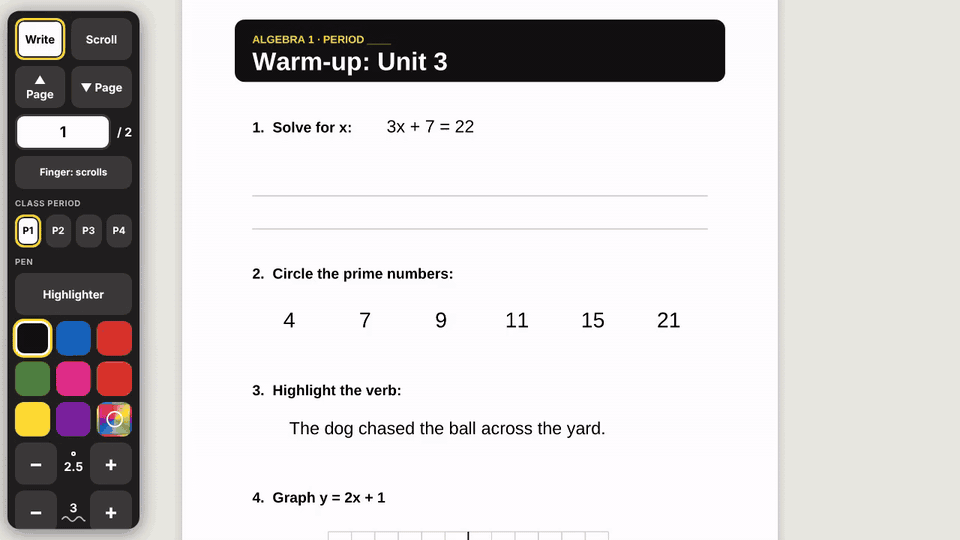

# OverBoard

**Smartboard ink that sticks to the page.**



OverBoard is a free writing layer for interactive whiteboards. Write on a worksheet with the board pen, scroll, and your ink scrolls with the page instead of floating on top of the screen. Wipe with your palm to erase. Highlight without covering the words. Save a PDF with the ink on it.

It runs in the browser. No accounts, no uploads; your ink stays on your machine.

**[Try the demo →](https://bpmdata.github.io/OverBoard/)** · **[Write on a PDF or HTML worksheet →](https://bpmdata.github.io/OverBoard/app/)**

## Why this exists

The ink tool that ships with a lot of classroom smartboards draws on a see-through layer over the whole screen. It has no idea what's underneath, so when you scroll a worksheet, the ink stays put and ends up on top of the wrong question. OverBoard draws *inside* the page, so ink always stays where you wrote it.

## Features

- **Ink that scrolls with the page**, and stays lined up when you zoom or resize the window
- **Write in the margins**: the blank space beside the page is writable too (it just doesn't print)
- **Palm eraser** on SMART Boards: wipe with your palm, fist or the side of your hand
- **Finger scrolls, pen writes**, with a toolbar switch if you lose the pen
- **Highlighter** that sits behind the printed text, so words stay readable
- **Cover**: tap the **▾** beside Highlighter and pick a cover to black out answers; wipe it away with your palm to reveal them. The same menu sets **highlight strength** (10–100%)
- **Undo and Redo** (↶ ↷ on the toolbar, or Ctrl/⌘+Z and Ctrl/⌘+Y, Ctrl/⌘+R or Ctrl/⌘+Shift+Z). Reloading from the keyboard is turned off, so a slip can't throw away the page
- **8 colors + a custom color picker**, pen size and smoothing controls (hold − / + to repeat)
- **Separate ink for each class period** (P1–P4) on the same worksheet
- **Save PDF** with crisp ink, page by page
- **Clear page / Clear all** (Undo brings either back), and **− / Fit / +** zoom that keeps the toolbar the same size, on PDFs and HTML worksheets alike. On a small screen (a laptop) the toolbar shrinks to fit instead of scrolling
- **PDFs too**: worksheets or whole textbooks, with a chapter list, page jump, and **Export PDF** with your ink drawn in
- **The PDF's text stays text**: select and copy it, follow its links, and search the whole book (great with OCR'd scans). Exports keep it.
- **Autosave** in the browser, plus optional **save ink into the .html file** itself (Chrome/Edge)
- **Hide the toolbar** down to a small button when you want the whole screen
- **Install the PDF app** in Chrome or Edge: it opens from the Dock or Start menu and works with no internet

## Use it on a PDF

Open **[bpmdata.github.io/OverBoard/app](https://bpmdata.github.io/OverBoard/app/)** and drop in a PDF (or tap to choose one). The PDF opens in the browser; nothing is uploaded.

- **Same toolbar** as the HTML overlay: pen, highlighter, palm eraser, finger scrolls, colors, size, smoothing, class periods P1–P4, undo and redo, Clear page / Clear all, zoom and File ▸.
- **Cover answers**: tap **▾** next to Highlighter and choose **Cover** (black, dark gray or light gray). It draws a solid bar over the page, text included; wipe it with your palm or the eraser to reveal the answer, or Undo. Tap ▾ ▸ **Highlight** to go back to the see-through highlighter; the **Highlight strength** slider there (10–100%) makes highlights lighter or bolder, and printed text stays black at any strength. Covers export as solid bars, but the text under them is still in the exported PDF (anyone can copy it), so OverBoard tells you when you export.
- **Clear page** clears the page you're looking at; **Clear all** clears every page (tap twice). A PDF with a chapter list has **Chapters** in that row instead, and **Clear ▸** opens the same two choices beside it. Both clear only the current class period, and Undo brings it back. A one-page PDF just has **Clear** (tap twice).
- **Big books are fine.** Only the pages near the screen are drawn, so a 600-page textbook scrolls smoothly. Type a page number in the box, or tap **Chapters** if the PDF has a table of contents.
- **Zoom** with − / Fit / +, or pinch on a trackpad. Ink stays on the page at any zoom.
- **Text and links work like a normal PDF reader** in **Scroll** mode: drag across text to select and copy it (scanned PDFs too, if they were OCR'd), tap a link in a contents page to jump there, and web links open in a new tab. In **Write** mode the pen, palm and finger work exactly as before; the text never gets in the way.
- **Find text** (File ▸ Find text…, or Ctrl/⌘+F) searches every page of the PDF, not just the ones on screen. Tap a result to jump to it.
- **Ink saves automatically** in this browser, matched to the exact PDF file. The PDF is kept too, so it's under **Open again** next time. If the page reloads, the PDF reopens where you were, with every stroke.
- **Export PDF** downloads a copy of the PDF with the current period's ink drawn in as sharp vector lines, named for the period (`Moby_Dick_annotated_P1.pdf`). Share it, print it, or post it to your class. The original text and links stay in it, so it can still be searched and copied.
- **Save ink / Load ink** moves your ink between computers as a small `.overboard.json` file. Open the same PDF on the other computer, then load (or drop) the ink file.
- **Save ink into PDF** (optional, off until you turn it on) keeps all periods' ink inside a PDF file you choose, by default a new `Name_board.pdf`. The pages aren't changed: the ink is added at the end of the file, so other apps show the plain PDF. Open that file in OverBoard on any computer and keep writing. In Chrome or Edge it then saves into the file automatically; tap the button again to stop. Other browsers get a one-time download.

Word files: in Word, choose File → Save as PDF, then open the PDF.

### Install it (works offline)

After you've opened the app once, it keeps a complete copy of itself in the browser, so it opens, opens PDFs, takes ink and exports with no internet (a dropped Wi-Fi in class doesn't matter).

To install it on a Mac with Chrome: open the [app](https://bpmdata.github.io/OverBoard/app/) and click **Install app** on the start screen (or the install icon at the right end of the address bar). OverBoard PDF then opens in its own window and lives in Launchpad and `~/Applications/Chrome Apps`; drag it to the Dock to keep it there. To open a PDF from Finder, right-click it ▸ **Open With** ▸ **OverBoard PDF** (Chrome asks once whether to allow it). Edge on Windows works the same way. Uninstall from the app window's ⋮ menu.

Updates install themselves: a new version downloads in the background in full, then switches the next time you open OverBoard (if another OverBoard window or tab is open, after you close them all). Your ink and the PDFs under **Open again** are kept.

Everything the app needs, including the PDF reader ([PDF.js](https://mozilla.github.io/pdf.js/)) and [pdf-lib](https://pdf-lib.js.org/) for Export PDF, comes from this site (bpmdata.github.io), so it works behind school web filters that block other sites.

## Use it on your own worksheets (HTML)

**Option 1: in the browser (easiest, works on school laptops).** Open the [app](https://bpmdata.github.io/OverBoard/app/) and drop your `.html` file on it. It saves a `Name_board.html` copy with OverBoard added (or upgraded, keeping saved ink), and your original is left alone. Double-click the copy to open it. Nothing to install, so it works on locked-down Windows laptops. (If the worksheet uses pictures stored as separate files, the app tells you to keep the copy in the same folder as the original.)

**Option 2: the desktop installer**, for converting a whole folder at once. Download this repo, then double-click:

- Mac: `overlay/Ink Overlay Installer.command`
- Windows: `overlay/Ink Overlay Installer.bat` (needs [Python 3](https://www.python.org/downloads/), which many district laptops don't allow; use Option 1 instead)

Pick your `.html` files. By default the installer makes a `Name_board.html` copy for the board and leaves your original alone. If a file already has an older OverBoard, it upgrades it and keeps any ink saved inside.

From a terminal:

```bash
python3 overlay/ink_overlay_installer.py worksheet.html --open
```

The toolbar matches the PDF app's: **− / Fit / +** zoom the worksheet but not the toolbar (ink stays on the page; Ctrl+scroll or a trackpad pinch works too), **Clear page | Clear all** (a worksheet without `.page` sections gets one **Clear**), and **File ▸** holds Save PDF, Save ink into file, Change linked file and Move toolbar.

**Option 3: paste it in.** Copy everything in [`overlay/ink_overlay.html`](overlay/ink_overlay.html) and paste it just before `</body>` in any HTML file.

Worksheets built from fixed-size `.page` elements (like `<div class="page">` at 8.5×11 in) get page-by-page jumping, **Clear page**, Fit zoom and PDF output. Other pages still work and print as one long sheet.

## For contributors

- `app/` is the PDF app: plain ES modules, served as-is (open `http://localhost:8000/app/` after `python3 -m http.server`).
- **The PDF app and the HTML overlay always have the same features.** A toolbar button, shortcut or behavior added to one goes into the other in the same pull request (bump the overlay's version in its first line).
- `shared/ink-core.js` (drawing, smoothing, pen/palm/finger rules, keyboard shortcuts, toolbar helpers) and `shared/toolbar.css` are used by both the PDF app and the overlay.
- **After editing anything in `app/` or `shared/`, run `python3 tools/build.py`.** It copies the shared code into the paste-in overlay (which must stay one self-contained file) and the demo page, and updates the app's version stamp (`app/version.json`), so browsers never mix old and new files after an update. `--check` fails if you forgot.
- **Offline copy.** `app/sw.js` (a service worker) caches every file in `app/` and `shared/`. `tools/build.py` writes the file list at its top, with each file's SHA-256, so it can't go out of date (`--check` catches it). A new version is only used once every file has downloaded and matches; it switches in one step and then the old copy is deleted. The manifest is `app/manifest.json`; icons are drawn by `tools/make_icons.py`.
- **Libraries** (PDF.js, pdf-lib) live in `app/vendor/`, so the app works behind school web filters that block CDNs. Versions are pinned in `app/libs.js`; after changing one, run `python3 tools/vendor_libs.py` (downloads from npm and verifies checksums).
- **Tests** run in a real browser (Playwright): pen, palm, finger, highlighter, zoom alignment, text selection and links, search, saving, ink files, Export PDF (and that it keeps the PDF's text), Save ink into PDF, HTML board copies, the overlay, and offline use and updates.

  ```bash
  npm install
  npx playwright install chromium
  npm test
  ```

  They run on every pull request (`.github/workflows/test.yml`), along with both `--check`s. Test PDFs are in `tests/fixtures/`.

## Smartboard tips

- **Turn off the board's own ink tool** so it doesn't fight OverBoard. On a Mac with SMART software, this stops SMART Ink from starting:

  ```bash
  launchctl disable gui/$(id -u)/com.smarttech.ink
  ```

  Keep the board's **drivers** installed. They're what let OverBoard tell your palm apart from the pen.
- **Test your board** with [`tools/board-probe.html`](tools/board-probe.html). It shows what the browser (and the SMART driver, if present) report for pen, finger and palm. If OverBoard misbehaves on your board, paste the probe's log into an issue.
- Holding a finger still on some SMART Boards is swallowed by the driver until you move. Pen holds work everywhere.

## Privacy

No accounts, no uploads; your ink stays on your machine.

- OverBoard has no server. Ink, and PDFs you open in the app, are stored in your browser, and inside your own file if you choose.
- What does get downloaded: the web pages (kept in the browser for offline use) and the two open-source libraries the PDF app uses ([PDF.js](https://mozilla.github.io/pdf.js/) and [pdf-lib](https://pdf-lib.js.org/)), all from GitHub Pages (bpmdata.github.io). Your PDFs, worksheets and ink are never sent anywhere. (The board-probe diagnostic page also loads one script from cdnjs.)
- The optional desktop installer is a Python script that runs on your computer and only edits the files you pick.

## Contributing

Issues and pull requests are welcome, especially reports from boards other than SMART (Promethean, ViewSonic, Surface, iPad). Include the output of the board probe.

## License

[MIT](LICENSE). SMART Board is a trademark of SMART Technologies. OverBoard is an independent project and is not affiliated with or endorsed by them.
